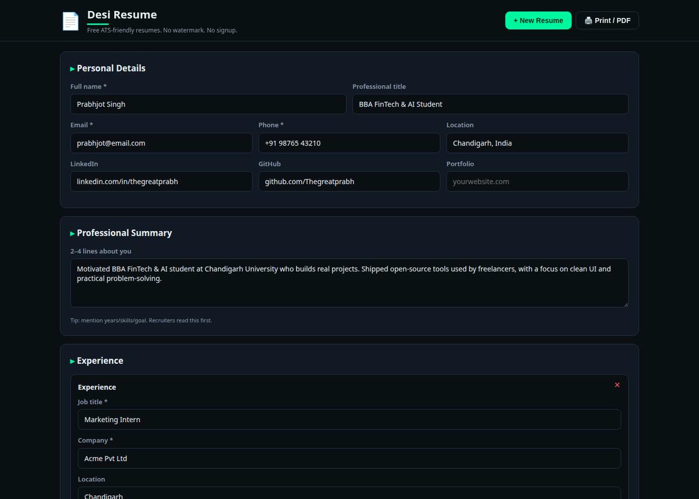
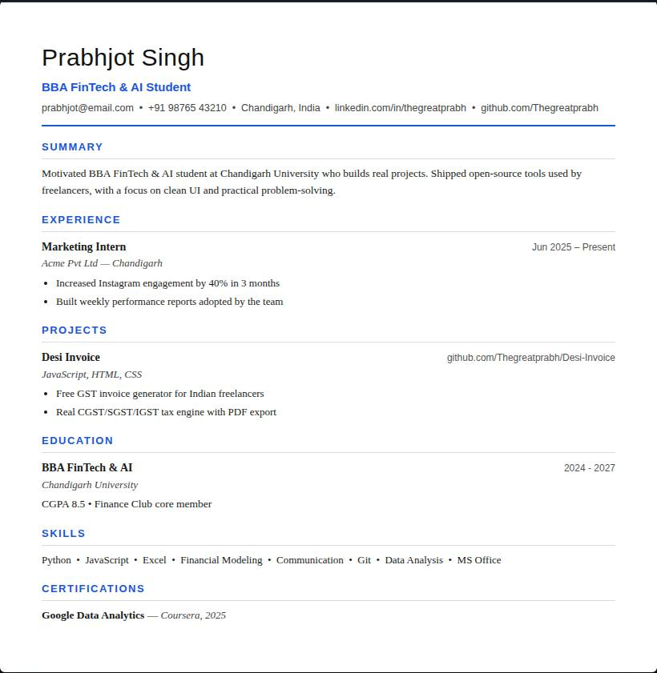

```bash
root@prabh:~# ./desi-resume --mode ghost
> ATS-friendly resume builder // OFFLINE // ZERO SIGNUP // ZERO WATERMARK
> STATUS: OPERATIONAL ✔
```

<p align="center">
  <a href="https://thegreatprabh.github.io/Desi-resume/">
    
  </a>
</p>

<p align="center">
  
  
  
  
</p>

# DESI RESUME

**Free ATS-friendly resume builder for Indian students & job seekers.**

Paid resume builders charge you to download **your own** resume — usually with a watermark tax. **Desi Resume** is free forever: fill the form, watch the live preview, print to PDF.

### ⚡ Arsenal

- **ATS-friendly by design** — single-column layout, standard section headings, no graphics/tables. Applicant Tracking Systems reject ~75% of resumes before a human sees them; this one is built to survive them.
- **Live ATS checklist** — real-time score on contact completeness, summary length, skills count, quantified achievements ("increased by 40%"), and action verbs.
- **Dynamic sections** — experience, projects, education, certifications: add as many as you need, one per line for bullet points.
- **4 font styles + 5 accent themes** — Classic Serif, Modern Sans, Elegant, Compact. One click, live preview.
- **Watermark with transparency control** — upload your logo/monogram, dial the opacity (4–30%), toggle on/off. Prints exactly as shown.
- **Smart Autofill** — paste your LinkedIn About or bio; it extracts name, email, phone, links and skills into the form automatically. No server, runs locally.
- **Print / Save as PDF** — pixel-clean A4 output, exactly what you see.
- **Autosave** — everything stays in your browser. Close the tab, come back, it's all there.
- **100% private** — localStorage only. Your career data never leaves your device.

### 📸 Intel

<p align="center">
  
  <br><sub>Fill the form — live preview + ATS checklist update instantly</sub>
</p>

<p align="center">
  
  <br><sub>Clean single-column resume that ATS software actually parses</sub>
</p>

### 🚀 Deployment

**Option 1 — instant:** open `index.html` in any browser. Done.

**Option 2 — hosted:** enable GitHub Pages on this repo (`Settings → Pages → main branch`) and share your link.

No build step. No dependencies. No npm. Works offline.

### 🧠 Why ATS-friendly matters

Most big companies filter resumes through software before any human reads them. Fancy two-column templates with icons and graphics get **misparsed or rejected**. Desi Resume uses the boring-but-effective format recruiters' systems actually understand — then makes it look sharp anyway.

> ⚠️ A great resume gets you shortlisted; skills get you hired. Keep building real projects.

### 🛠️ Stack

Vanilla HTML + CSS + JS. Zero dependencies, zero build.

```
desi-resume/
├── index.html      # app shell
├── css/styles.css  # dark UI + print stylesheet
└── js/app.js       # state, rendering, ATS engine
```

### 🤝 Join the operation

Found a bug? Know an ATS nuance I missed? Open an issue or PR.

### 📄 License

MIT — free forever, for everyone.

---

<p align="center"><sub>// built in the dark, shipped for the light 🇮🇳 — if it got you shortlisted, drop a ⭐</sub></p>
